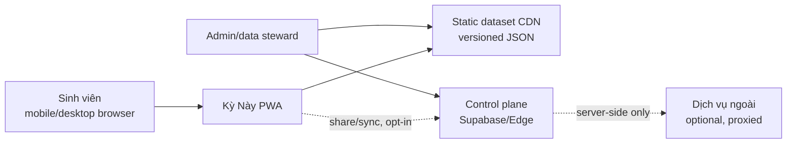
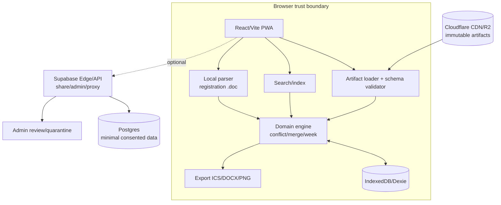

# Architecture — local-first timetable platform

> **Status:** proposed  
> **Owner:** Tech Lead  
> **Last reviewed:** 2026-10-20
> **Related docs:** [Tech stack](TECH_STACK.md), [Domain model](DOMAIN_MODEL.md), [API contracts](API_AND_DATA_CONTRACTS.md), [Security](SECURITY_PRIVACY.md)

## 1. Architecture goals

1. Tạo Plan và xem lịch được mà không cần tài khoản.
2. File registration result không rời thiết bị.
3. Dataset công khai tải nhanh, có version/hash/provenance và rollback.
4. Parser thay đổi độc lập với UI; school-specific config không rải trong component.
5. Backend là control plane tối thiểu, không là nơi bắt buộc cho core timetable.
6. Có thể thêm trường khác mà không đổi canonical domain model.

## 2. System context

## 3. Container view

## 4. Data flows

### 4.1 Public timetable

1. Admin chọn file/nguồn được phép → quarantine.
2. Parser detect format, normalize thành canonical records, validate invariants.
3. Diff với bản hiện hành; report additions/changes/removals.
4. Hai người/role được ủy quyền review candidate.
5. Build immutable JSON artifact + manifest/hash.
6. Publish CDN; app fetch manifest, kiểm tra schema/hash, cache theo version.
7. Bản sai được retraction/rollback về version trước; user thấy version/provenance.

### 4.2 Registration result

1. User chọn file trong file picker.
2. Browser đọc bytes; parser kiểm tra type/size và parse HTML `.doc`.
3. Extract candidate schedule fields; loại họ tên/ngày sinh/mã sinh viên ngay tại boundary parser.
4. Preview normalized records và warnings; user confirm.
5. Merge với Plan: registration override phòng/giờ; lưu field provenance local.
6. Không upload raw bytes hoặc PII; analytics chỉ có event tổng hợp nếu consent.

### 4.3 Optional sync/share

1. User chủ động chọn “share/sync”.
2. Client tạo DTO tối thiểu, không raw file; user chọn trường dữ liệu được chia sẻ.
3. API auth/rate-limit/validate; RLS giới hạn owner/access token.
4. Link read-only có expiry/revoke; delete cascade khi owner xóa.

## 5. Component responsibilities

| Component | Trách nhiệm | Không làm |
| --- | --- | --- |
| Artifact loader | fetch manifest, schema/hash, cache/update | không parse file user |
| Parser | raw row → canonical candidate + provenance/errors | không publish, không bỏ warning |
| Domain engine | search, conflict, merge, week/date | không gọi API/analytics |
| Local store | Plan, settings, overrides, migrations | không lưu raw PII quá retention |
| UI | interaction, explanation, responsive/accessibility | không tự viết rule domain trong JSX |
| Export | serialize Plan với source/version | không gửi lịch lên server |
| API/control | share/admin/proxy/auth | không nhận registration raw |
| Admin review | human approval/retraction | không approve thiếu evidence |

## 6. Caching và offline

- App shell precache sau first load.
- Manifest `max-age` ngắn; artifact immutable có `immutable` cache.
- IndexedDB lưu dataset version đang dùng và Plan.
- Khi có version mới, không tự phá Plan: thông báo diff, user chọn migrate/rebase.
- Offline: xem Plan/dataset đã cache, conflict/export; không tạo share hoặc fetch version mới.
- Nếu hash/schema fail: bỏ response, giữ bản cache cuối và hiển thị stale/error, không parse mù.

## 7. Trust boundary và threat boundary

- Boundary A: browser file input — PII chỉ tồn tại local memory/IndexedDB theo policy.
- Boundary B: CDN public artifacts — chỉ dữ liệu lịch đã duyệt, không secret/PII.
- Boundary C: control plane — auth/share/admin; cần RLS, RBAC, audit, rate limit.
- Boundary D: external service — chỉ proxy từ server, request đã redacted/consented, budget cap.

Mọi crossing boundary phải có data contract và security review. Nếu crossing mở PII/vendor/auth/external boundary mới, phải có design-time Security approval ở **G1** trước khi freeze contract; sau implementation, **G3b** xác minh controls thực tế, không chỉ dựa trên design review.

## 8. Failure modes

| Failure | Hành vi an toàn |
| --- | --- |
| CDN down | dùng cache, hiện version/stale status |
| Artifact schema/hash fail | reject artifact, không overwrite cache |
| Parser không hiểu cột/note | candidate + error/warning, admin review |
| Registration không khớp LHP | không tự đoán; cho user sửa/skip, giữ raw chỉ local nếu user chọn |
| IndexedDB bị xóa | app khởi tạo trống; không giả vờ đã sync |
| API auth/share down | core local vẫn dùng; retry có backoff |
| External API timeout/quota | không block lớp học; hiển thị “chưa có dữ liệu” |
| Data correction | publish version mới + diff + rollback path |

## 9. Observability

- Client errors: error code, app version, dataset version, browser family; scrub URL/query/file content.
- Parser metrics: candidate count, valid/rejected count, unknown headers/notes, warning histogram, parse duration.
- Product metrics: aggregate event không có PII; consent/opt-out.
- Alerts: artifact publish fail, schema fail, parser valid-rate drop, API spend/rate threshold, error spike trong mùa đăng ký.

## 10. Architecture decisions cần review

- M1 implementation currently provides the offline `packages/parser` and `packages/domain` foundation plus synthetic fixture evidence. The browser/PWA containers, artifact loader, IndexedDB, domain engine, UI, export and control plane below remain target architecture for later milestones.
- Vì chưa có mã nguồn ứng dụng web/PWA, sơ đồ này là target architecture; implementation M1 chỉ covers parser/domain package boundaries và không chứng minh runtime/browser controls.
- Supabase chỉ được bật sau `SECURITY_PRIVACY.md` và data-region review.
- PDF/LLM/third-party review không được trở thành dependency để xem lịch core.
