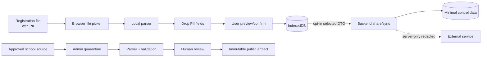

# Security, privacy và threat model

> **Status:** draft / required gate  
> **Owner:** Security Reviewer  
> **Last reviewed:** 2026-10-25
> **Related docs:** [Architecture](ARCHITECTURE.md), [Tech stack](TECH_STACK.md), [Operations](OPERATIONS.md)

> Tài liệu này là baseline kỹ thuật, không phải tư vấn pháp lý. Trước khi thu tiền, lưu account hoặc mở vendor/cross-border processing, cần rà soát với người có chuyên môn và quy định hiện hành.

## 1. Security objectives

- Không để file kết quả đăng ký và PII rời thiết bị trong core flow.
- Không xin/nhận mật khẩu cổng sinh viên, không tự động đăng ký.
- Dataset public không chứa PII và có integrity/provenance.
- Admin ingestion fail closed; chỉ publish sau validation và review.
- Share/sync là opt-in, minh bạch field/expiry/revoke.
- Secret, external API key và admin capability chỉ ở server/secret manager.
- Design-time threat/data-flow review ở **G1** là bắt buộc khi feature mở boundary PII/vendor/auth/external mới.
- Implementation-time verification ở **G3b** phải chứng minh controls đã triển khai; G1 không thay thế G3b.
- Incident có owner, evidence và khả năng rollback/notify.
- Data Reviewer xác nhận candidate dataset độc lập; Release Manager là accountable cho publish/retract/rollback.

## 2. Data inventory và classification

| Data | Ví dụ | Classification | Nơi được phép | Retention mặc định |
| --- | --- | --- | --- | --- |
| Public timetable | course/section/session/room | Public/Integrity-sensitive | CDN, browser cache | đến khi superseded/retracted |
| Source document metadata | hash, source ref, parser version | Internal/Public subset | admin store/manifest | theo provenance policy |
| Registration PII | họ tên, ngày sinh, mã SV | Sensitive personal | browser memory/IndexedDB user-controlled | xóa khi user xóa/import cleanup |
| Derived personal Plan | môn/giờ/phòng user chọn | Personal | local; server chỉ khi share consent | user-controlled/expiry |
| Admin identity/audit | user id, action, timestamp | Restricted | control plane | policy/legal review |
| Analytics | aggregate event, app/dataset version (cookieless, no user ID, no IP) | Low sensitivity | local counter aggregate hoặc self-hosted Umami tương đương | shortest useful period |
| Secrets | API keys, signing keys | Secret | secret manager only | rotation schedule |

- Registration artifact metadata is local-only: no content hash, user-selected filename, raw HTML or identity field may enter telemetry, logs, network DTOs or shared evidence. Approved non-PII timetable inputs retain a provenance hash.
- M1 parser package và M2 pure domain engine đã kiểm tra local bằng synthetic fixtures/unit tests; M2 không thêm network, storage, credential hoặc external-service boundary. Đây chưa phải browser/network G3b evidence. Khi app có file picker ở M3/M4, phải chạy interception test để chứng minh raw registration bytes/PII không vào request, log, analytics hoặc Sentry.
- M3 (2026-10-25, chưa commit): web app chưa có file picker và không xử lý PII. [G3b M3](evidence/M3-G3b-SECURITY-REVIEW.md) (agent role, chưa phải sign-off của người) kết luận `security-pass-with-exception`: chỉ request GET cùng origin, không analytics/cookie/localStorage, dữ liệu dataset hiển thị như text trong UI/Word/ICS/PNG, CSP build chặn script inline. 7 finding S3 còn mở (SEC-M3-001…007: dataset thu hồi hiện lại khi offline, `%2e%2e` lọt qua kiểm tra URL, cờ build cho dữ liệu chưa công bố, giới hạn kích thước khi thiếu Content-Length, lint guard yếu, wipe chưa sạch khi nhiều tab, thiếu header khi deploy). SEC-M3-005 và SEC-M3-006 phải đóng trước G3b của M4 vì M4 sẽ lưu dữ liệu suy ra từ file đăng ký.
- CI/repository không chứa raw source có PII, `.env`, token hoặc fixture chưa redacted.

## 3. Data-flow controls

Raw registration bytes không có mũi tên đến API/DB/log/analytics. Browser network test phải chứng minh điều này.

## 4. Threat model

| Threat | Asset/impact | Control | Evidence |
| --- | --- | --- | --- |
| User uploads PII accidentally | privacy/legal | local parse, redaction, CSP/network tests | automated + manual |
| Malicious file/parser payload | browser/client integrity | type/size limit, no execution, sandboxed parsing, dependency update | security test |
| Forged dataset | wrong timetable/trust | hash/schema/signing where feasible, provenance/review | artifact test |
| Admin account takeover | public data poisoning | MFA where supported, RBAC, two-person publish, audit | access test |
| Share token guessing/leak | schedule privacy | high entropy token, expiry/revoke, no owner identity | API test |
| XSS from course/lecturer/room text | browser execution | output encoding, CSP, sanitize HTML, fixture payload | e2e/security |
| SSRF/external abuse | backend | allowlisted outbound, no user URL fetch, timeout | API test |
| API/LLM cost abuse | budget/availability | auth, rate limit, quota, circuit breaker | load/drill |
| Dependency compromise | supply chain | lockfile, provenance, review, SCA | CI evidence |
| Stale/incorrect data | user decisions | updated-at/source link, report issue, rollback | runbook drill |

## 5. Client controls

- CSP, secure headers, no inline dynamic HTML unless sanitized.
- File parsing in isolated module/worker where practical; never evaluate file content as script.
- MIME/extension/size validation; malformed input returns safe error.
- IndexedDB schema migration validates and drops unsupported records safely.
- Sensitive data omitted from errors, console logs, Sentry breadcrumbs and analytics.
- Export filenames and visible text escape user-derived values.
- Service worker update must not silently serve mixed schema/version.

## 6. Server/admin controls

- Secrets only in environment/secret manager; rotate and audit access.
- RBAC enforced server-side; RLS for user-owned share records.
- Admin import quarantine is separate from published bucket/prefix.
- Two-person approval cho first publish/new parser version; Data Parser không phải approver duy nhất, Data Reviewer phải độc lập.
- Design-time Security approval ở G1 cho boundary PII/vendor/auth/external mới; implementation verification ở G3b.
- Upload content-disposition/no execution, size limits, malware scan where server receives source.
- Audit events: actor role, action, artifact id/hash, result, timestamp, reason; no raw file/PII.
- Rate limits and budget caps for share, import, external proxy and LLM.
- Backups encrypted and deletion policy documented; restore drill before production.

## 7. Privacy UX and retention

- Privacy notice explains local processing, optional share/sync, analytics and deletion.
- **Analytics (Q-008):** không GA/tracker bên thứ ba; chỉ aggregate counter cookieless (không user ID, không lưu IP), có privacy notice + nút tắt; đo theo từng người chỉ khi opt-in; kiểm tra lại với người hiểu luật trước khi bật.
- User sees exactly what a share link reveals; default hides course names if feature design chooses busy/free.
- Share links created as client-side URL fragments in the MVP do not have server-side expiry or revocation; the UI must warn “ai có link sẽ xem được”. Expiry/revoke is required only when server-backed share is introduced post-MVP.
- “Delete local data” clears Plan/import-derived data/cache according to app capability; provide export first if useful.
- Account deletion removes server-owned share/sync records within policy SLA.
- Do not derive sensitive profiles from schedule or expose student identity through public URL.
- Cross-border/vendor transfer, legal basis/consent and data region are open gates, not assumptions.

## 8. LLM/external service rules

- Disabled for MVP core; rule-based parser remains complete path.
- If enabled for admin fallback: redact, send minimum string set, constrain JSON schema, validate, human approve, cache, budget cap and delete input according to policy.
- No raw registration documents or PII to model.
- External ratings only via server proxy after written data/attribution agreement; show source link and sample threshold.

## 9. Security acceptance criteria

- [ ] No raw registration bytes/PII appear in network requests, analytics, logs or Sentry.
- [ ] Portal credential fields do not exist in UI/API.
- [ ] Dataset hash/schema/provenance validation blocks invalid artifact.
- [ ] Admin role matrix tested; non-admin cannot publish/retract.
- [ ] Share token expiry/revoke/access checks tested.
- [ ] XSS/file parser/SSRF/rate-limit dependency checks pass.
- [ ] Secret scan and dependency audit pass; findings have owner.
- [ ] Backup/restore and artifact rollback drill has evidence.
- [ ] Privacy notice and deletion flow reviewed before account/sync release.

## 10. Incident response

1. Triage severity and contain: disable endpoint/publish/feature; preserve scrubbed evidence.
2. If PII/secret exposure suspected: stop logs/connector, revoke/rotate secret, invalidate tokens, limit access.
3. Identify scope via requestId/artifact/audit without copying raw data.
4. Fix and test; rollback bad artifact or deploy.
5. Notify owner/affected parties/regulator as required by reviewed policy.
6. Post-incident action items, owner and due date; update threat model/runbook.
