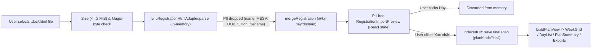

# M4 design handoff — Registration merge UI

> **Artifact ID:** `DESIGN-M4-001`  
> **Artifact status:** `in-review`  
> **Canonical gate:** `G1`  
> **Owner:** Tech Lead + Frontend  
> **Last reviewed:** 2026-11-06  
> **Related docs:** [M4 spec](M4-SPEC.md), [ADR-0013](../adr/ADR-0013-m4-registration-merge-ui-and-privacy-boundary.md), [Architecture](../ARCHITECTURE.md), [Domain model](../DOMAIN_MODEL.md), [Security & privacy](../SECURITY_PRIVACY.md)  
> **Evidence envelope:** `EVID-M4-001` ([M4-EVIDENCE-ENVELOPE.md](M4-EVIDENCE-ENVELOPE.md))  
> **Decision actor / UTC timestamp:** Pending Owner (Tech Lead) human sign-off

## 1. Context and source

- **Source:** `SPEC-M4-001`; `IMPLEMENTATION_PLAN.md` §2 (M4 row), §4 step 8; `ADR-0013`.
- **Constraints:**
  - Browser registration import is 100% local-only (`AC-04`): zero network requests, zero PII or filename/hash retention in `IndexedDB`, `DOM`, `console`, or exports.
  - Only `@ky-nay/parser/registration` may be imported by `apps/web` (enforced by `scripts/lint.mjs`).
  - Two fixed Plan slots per term (`draft` vs `final`, `Q-005`): importing registration creates/updates `final` without mutating `draft`.
  - Override provenance (`from → to`, `AC-05`, `FR-10`) must be visible across `WeekGrid`, `DayList`, `PlanSummary`, `PrintSheet`, and `.ics`/`.doc` exports.

## 2. Module design

| Module | Responsibility | Depends on |
| --- | --- | --- |
| `scripts/lint.mjs` | Enforce `@ky-nay/parser/registration` subpath-only import and forbid `node:*` imports in `apps/web/src` alongside existing network/XSS/storage/PII guards | Node fs/path |
| `packages/domain/src/plan.ts` & `registration-merge.ts` | Export `applyPlanOverrides` and apply `plan.overrides` in `resolvePlanPicks(plan, catalog)` so resolved sessions always reflect effective overrides (`registration < admin-correction < user`) | `@ky-nay/domain` |
| `packages/export/src/schedule.ts`, `format.ts`, `word.ts`, `ics.ts` | Attach `overrides?: readonly SessionOverride[]` (`badge`, `detail` with `from → to`) to `ScheduledSession` and include override notes in Word `.doc` and `.ics` descriptions | `@ky-nay/domain` |
| `apps/web/src/model/registration.ts` | Pre-parse file size/magic-byte check, invoke `vnuRegistrationHtmlAdapter.parse` + `mergeRegistration`, inherit group/week1 (`D-M4-1`), build PII-free `RegistrationImportPreview` (matched sections, overrides `from → to`, unmatched sections, warnings/errors) | `@ky-nay/domain`, `@ky-nay/parser/registration`, `@ky-nay/export` |
| `apps/web/src/model/plan-view.ts` | Pass `plan.overrides` into `scheduledSessions`; update `rebasePlan` to refresh `override.from` against the new catalog and drop redundant registration overrides when the new timetable matches | `@ky-nay/domain`, `@ky-nay/export` |
| `apps/web/src/storage/plan-store.ts` & `local-data.ts` | Add `deletePlan(db, planId)` and store per-term `activePlanKind` + PII-free unmatched registration notes in `Settings` | `IndexedDB` |
| `apps/web/src/app/controller.ts` | Expose `deletePlan`, `activePlanKind` / `setActivePlanKind`, and per-term unmatched registration notes | `storage`, `data`, `model` |
| `apps/web/src/components/RegistrationImport.tsx` | File picker panel/modal, in-app browser nudge (`Q-007`), PII-free preview of matched sections, `from → to` overrides, unmatched sections & warnings, and explicit Confirm / Cancel actions | `model/registration`, `components/common` |
| `apps/web/src/components/Workspace.tsx`, `PlanSummary.tsx`, `Schedule.tsx` | 2-slot switcher (`Phương án nháp` / `Phương án chính thức`), button to open Registration Import, inline group selector in `PlanSummary` for multi-group picks, delete `Phương án chính thức` action, and `Đã đổi…` badges + `from → to` details | `model`, `components` |

## 3. Data flow and privacy boundary

- **Trust boundary:** `File` bytes never leave `parseRegistrationFile` in `apps/web/src/model/registration.ts`. Neither `file.name` nor any student identity field is returned in `RegistrationImportPreview` or stored in `IndexedDB`.

## 4. Verification plan

- **Static & boundary checks:** `npm run lint` and `npm run typecheck`.
- **Package unit tests (`node:test`):**
  - `packages/domain/test/registration-merge.test.ts` & `plan.test.ts`: `resolvePlanPicks` applies `plan.overrides` for room, day, periods, weeks, lecturer; conflict detection reflects overridden day/periods.
  - `packages/export/test/export.test.ts`: `scheduledSessions` formats `SessionOverride` badges (`Đã đổi phòng`, `Đã đổi thứ`, `Đã đổi tiết`, `Đã đổi tuần`, `Đã đổi cơ sở`, `Đã đổi giảng viên`) and `from → to` details; `buildWordDoc` and `buildIcs` include override notes.
- **Web unit/component tests (`Vitest`):**
  - `apps/web/src/model/registration.test.ts` & `apps/web/src/m4-registration.test.tsx`:
    - Parse `fixtures/redacted-registration/portal-format.doc` and assert zero PII tokens in preview/DOM/IndexedDB.
    - Guardrails for empty file, `> 2 MiB`, binary `.docx` (`PK\x03\x04`), binary `.doc` (`\xD0\xCF\x11\xE0`), and `.pdf`.
    - Preview → Cancel leaves `IndexedDB` and `draft` Plan untouched.
    - Preview → Confirm creates `Phương án chính thức`, switches slot to `final`, preserves `Phương án nháp`, renders `Đã đổi phòng`/`Đã đổi giờ` badges, surfaces `unmatched` warnings, allows inline group selection on `GROUP_REQUIRED`, supports re-import and deleting `Phương án chính thức`.
- **E2E tests (`Playwright`):**
  - `apps/web/e2e/m4.spec.ts`: full browser flow uploading `.doc` with PII, network & Service Worker request interception asserting 0 requests during import/confirm/export, `IndexedDB` & `DOM` PII scan, slot switching (`Phương án nháp` ↔ `Phương án chính thức`), override badges on grid/day/summary, and WCAG 2.1 A/AA axe checks at `360px` / `768px` / `1200px`.

## 5. Approval

- Product scope approval: pending Owner sign-off (`SPEC-M4-001`).
- Tech Lead & Security design review: documented in `ADR-0013` §4; pending Owner human sign-off.
