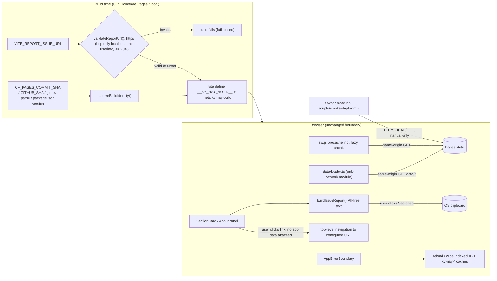

# M5 design handoff — Release hardening without telemetry

> **Artifact ID:** `DESIGN-M5-001`  
> **Artifact status:** `g1-approved`  
> **Canonical gate:** `G1`  
> **Owner:** Tech Lead (+ Frontend, Platform, Release Manager per work package)  
> **Last reviewed:** 2026-11-10  
> **Related docs:** [M5 spec (SPEC-M5-001)](M5-SPEC.md), [ADR-0014](../adr/ADR-0014-m5-release-observability-without-telemetry.md), [ADR-0010](../adr/ADR-0010-m3-web-app-artifact-storage-export.md), [ADR-0012](../adr/ADR-0012-dataset-publish-pipeline.md), [ADR-0013](../adr/ADR-0013-m4-registration-merge-ui-and-privacy-boundary.md), [Architecture](../ARCHITECTURE.md), [Security & privacy](../SECURITY_PRIVACY.md), [Operations](../OPERATIONS.md)  
> **Evidence envelope:** `EVID-M5-001` (file `M5-EVIDENCE-ENVELOPE.md` is created at G2; this handoff is `N/A — docs-only`, no build/test run)  
> **Decision actor / UTC timestamp:** Approved by Owner (Tech Lead + Security) at `2026-11-12T04:19Z` (chat)

## 1. Context and constraints

- **Source:** `SPEC-M5-001` (Product, drafted in parallel); Owner decisions `D-M5-1` (build M5 now, validate with real HK I `2026-2027-h1` on a preview branch, no production deploy/publish this round), `D-M5-2` (no runtime telemetry; observability = Pages deploy status + scripted smoke + manual checklist + user-initiated reports), `D-M5-3` (single maintainer, time-bound `--accept-single-reviewer` exception); `IMPLEMENTATION_PLAN.md` §2 M5 row. Base: `main` @ `0e849f1`, branch `m5-release-hardening`.
- **Invariants kept:** single network module `apps/web/src/data/loader.ts` (same-origin `data/*`); SW passes through same-origin `GET` only; CSP unchanged (`connect-src 'self'`, `form-action 'none'`); no `localStorage`/cookies; no `window.open`/`location` sinks (`scripts/lint.mjs`); dataset schema (`manifest 1.0`, domain `0.2.0`) and IndexedDB (`ky-nay` v1: `plans`, `datasets`, `settings`, `backups`) unchanged; production serves only `published` data.
- **Out of scope:** telemetry/counters/client error reporting (P1, legal review), admin web UI, staging env, custom domain/brand (D-001), the actual G4a deploy and G4b publish, HK II term config, parser/schema changes, manifest `statusMessage` slot (P1).
- **Measured baseline (read from the existing `apps/web/dist`, built 2026-11-10 from `0e849f1`, not rebuilt here):** `assets/index-VFNscEnB.js` 443,919 B raw / 140,045 B gzip (`gzip -c`, level 6); `assets/index-CvQa81Lv.css` 12,752 B / 3,474 B; one JS chunk; `sw.js` precache = `./`, both assets, `icon.svg`, `manifest.webmanifest`.

## 2. Module design per scope item

Paths are real files on `0e849f1` unless marked **new**. Note: labels live in `apps/web/src/model/labels.ts` and the SW client in `apps/web/src/app/sw-client.ts`.

| Item | Change (files) | Responsibility | Depends on |
| --- | --- | --- | --- |
| **M5-A** Build identity | **new** `scripts/lib/build-identity.mjs` + `build-identity.d.mts`; `apps/web/vite.config.ts` (`define` in **all** modes, not only build; build-only `transformIndexHtml` adds `<meta name="ky-nay-build" content="<version>+<commit>">`); **new** `apps/web/src/app/build-info.ts`, **new** `apps/web/src/build-env.d.ts`; `components/Chrome.tsx` (`Footer` shows "Phiên bản …"); `package.json` `version`; **new** `CHANGELOG.md` | `resolveBuildIdentity(env)` → `{ version, commit, builtAt, channel }` injected as `__KY_NAY_BUILD__`; `build-info.ts` is the only reader and falls back to `{version:"0.0.0-dev", commit:"unknown"}` when the define is absent (`typeof` guard) | root `package.json` |
| **M5-B** Report data issue | **new** `apps/web/src/model/report-issue.ts` (pure `buildIssueReport`, `looksLikePersonalInfo`); **new** `components/ReportIssue.tsx` (`ReportIssueProvider`, `useReportIssue`, `ReportIssueForm`); `components/SectionCard.tsx` ("Báo sai dữ liệu" disclosure per section, hidden when no provider); `App.tsx` (provider with current `DatasetEntry`); `vite.config.ts` (`__KY_NAY_REPORT_URL__` from `VITE_REPORT_ISSUE_URL`) | Build PII-free text; "Sao chép" via `navigator.clipboard.writeText` with read-only `<textarea>` fallback; optional `<a href={url} target="_blank" rel="noopener noreferrer">` to the configured URL **without** any query/fragment added by the app; draft note kept in React state only | M5-A, `model/labels.ts` |
| **M5-C** About/FAQ/privacy | **new** `components/AboutPanel.tsx`, **new** `model/about-content.ts`; `App.tsx` (`aboutOpen` state like `provenanceOpen`); `components/Chrome.tsx` (footer button "Giới thiệu, quyền riêng tư & báo lỗi") | Independence disclaimer, data sourcing/provenance, full privacy notice (local processing; IndexedDB stores listed; SW cache; deletion via "Xóa dữ liệu trên máy"; no telemetry/cookies/third parties), general report form, PRD §8 browser tiers, known limitations. No status slot (P1) | M5-B |
| **M5-D** Stale data | **new** `model/freshness.ts` (`datasetFreshness(entry, cachedAt, now)` → `{ expired, expiresAt?, ageDays, ageBasis }`); `App.tsx` `DatasetBanners` | Warning when `entry.expiresAt` < now; offline/cached notice adds "Dữ liệu công bố N ngày trước" from `publishedAt ?? reviewedAt ?? importedAt`; uses existing `useOnline()` and `Ready.cached` — no new network call | `data/contract.ts` types |
| **M5-E** Resilience | **new** `components/ErrorBoundary.tsx` (class `AppErrorBoundary`); `main.tsx` wraps `<App/>` | Fallback: disclaimer, "Tải lại trang" (`window.location.reload()`, allowed by lint), "Xóa dữ liệu trên máy rồi tải lại" (own `openDb()` → `wipeLocalData(db)`, confirm step), build id + error **name** only (never `message`/stack); no logging, no reporting | `storage/db.ts`, `storage/local-data.ts`, M5-A |
| **M5-F** Lazy registration import | **new** `components/registration-lazy.ts` (memoized `loadRegistrationImport = () => import("./RegistrationImport.js")`, `resetRegistrationImport()`); `components/Workspace.tsx` (replace static `import { RegistrationImportPanel }` with `React.lazy` + `<Suspense>` + local boundary; idle prefetch on mount); **new** `scripts/check-bundle-budget.mjs`, **new** `scripts/bundle-budget.json` | Lazy boundary is the **component**, because `RegistrationImport.tsx` imports `MAX_REGISTRATION_BYTES` and `model/registration.ts` imports `vnuRegistrationHtmlAdapter` (`@xmldom/xmldom`); `storage/local-data.ts` only has a type import (erased). Budget script classifies initial vs lazy chunks from `dist/index.html` | WP1 must land before thresholds are frozen |
| **M5-G** PWA icons | **new** `scripts/generate-icons.mjs`; **new** `apps/web/public/icons/{icon-192.png,icon-512.png,icon-maskable-512.png,apple-touch-icon.png}` (committed); `public/manifest.webmanifest`; `index.html` (`<link rel="apple-touch-icon" href="./icons/apple-touch-icon.png">`); `vite.config.ts` `PUBLIC_SHELL` (add the 4 PNGs so they are precached) | Chromium (`@playwright/test`, already installed) renders `public/icon.svg` (any) and a maskable variant (full-bleed `#0842a0`, glyph scaled into the 80 % safe zone, no `rx`) to PNG; apple-touch uses the maskable variant at 180 | Playwright Chromium locally; not run in CI |
| **M5-H** CI hardening | `.github/workflows/m0-foundation.yml`; **new** `scripts/secret-scan.mjs`, **new** `scripts/secret-scan-allowlist.json`; `package.json` scripts | Secret scan + `npm audit --omit=dev --audit-level=high` + base-ref fix + bundle budget (via `verify:bundle`) | §6 |
| **M5-I** Operations | `docs/OPERATIONS.md`; **new** `scripts/smoke-deploy.mjs` | Release/rollback/tag/changelog runbook; manual smoke (§7) | M5-A meta tag |
| **M5-J/K** Release pack, HK I guide | **new** `docs/evidence/M5-RELEASE-CHECKLIST.md`, **new** `docs/evidence/M5-RELEASE-REPORT.md` (`draft`, no deploy IDs), **new** `docs/evidence/M5-OWNER-HK1-VALIDATION-GUIDE.md` | Owner-only G4a/G4b/G5 steps; HK I run on a non-`main` preview branch, cleanup so `main` stays HK-I-free unless Owner decides | ADR-0012 CLI |
| **M5-L** Re-verify M4 + devices | none in G2 | Executed by Tester at M5 G3a (`F-M5-001`, S2 process/evidence, blocks G4a) | real code on G2 commit |

## 3. Data flow and privacy boundary (no new egress)

- **No new egress:** no new `fetch`/beacon/XHR/WebSocket; nothing is sent automatically. Clipboard is local. The report link is a user-initiated top-level navigation to a build-time constant; the app never appends report text, dataset IDs or notes to the URL (free-text notes may contain PII, and URLs are logged by third parties). `Referrer-Policy: no-referrer` already strips the referrer.
- **CSP/headers:** unchanged. CSP does not govern top-level anchor navigation; `connect-src 'self'` still blocks any programmatic call to the report host. `Permissions-Policy` does not restrict `clipboard-write` for self.
- **Lint:** existing rules already allow `<a href>`, `navigator.clipboard`, `window.location.reload()` and static-string `import("./RegistrationImport.js")`; they still reject `window.open`, `location.href/assign/replace`, dynamic specifiers. One **new** rule: identifiers `__KY_NAY_REPORT_URL__`/`__KY_NAY_BUILD__` may appear only in `apps/web/src/app/build-info.ts`, `apps/web/src/build-env.d.ts` and tests. Worker-scope rule on `vite.config.ts` forbids the token `fetch` outside `fetch(request)` — new config code must not use that word outside comments.
- **Report text** (`buildIssueReport`): app `version (commit, channel)`, `datasetVersion`, `termName (term)`, `status`, optional `sectionId (courseCode)`, field from a fixed list (giờ/tiết, thứ, tuần, phòng, giảng viên, nhóm, tín chỉ, khác), user note ≤ 500 chars. Never: Plan picks, registration data, unmatched notes, user agent, timestamps of local actions. `looksLikePersonalInfo` (8-digit MSSV-like number, dd/mm/yyyy date, email, phone `0\d{9}`) shows a warning; it does not block.
- **Runtime URL re-check:** `build-info.ts` re-parses the constant and exposes it only if `protocol` is `https:` (or `http:` with `localhost`/`127.0.0.1`), else `undefined` → copy-only UI.

## 4. Build identity injection (M5-A)

- **commit:** `CF_PAGES_COMMIT_SHA` → `WORKERS_CI_COMMIT_SHA` → `GITHUB_SHA` → `git rev-parse --short=7 HEAD` (`execFileSync`, 2 s timeout, stderr ignored) → `"unknown"`; truncated to 7 hex; validated `^[0-9a-f]{7}$` else `"unknown"`. A local build with a dirty tree appends `-dirty` (never in CI).
- **version:** root `package.json` `version` (single source; currently `0.0.0`, first tag proposed `v0.1.0` — Owner decision). **builtAt:** `SOURCE_DATE_EPOCH` if set, else build start, ISO UTC to the minute. **channel:** `production` | `preview` | `local`, using the same branch logic as `resolveBuildAllowUnpublished`.
- **Effect:** the identity enters the bundle, so the SW cache name changes on every commit; a docs-only deploy now shows the update banner. Accepted (deploys are deliberate).

## 5. Lazy-load plan (M5-F)

1. `registration-lazy.ts` holds one memoized promise; `React.lazy(() => loadRegistrationImport().then((m) => ({ default: m.RegistrationImportPanel })))`.
2. `Workspace` calls `loadRegistrationImport()` in an effect after mount (`requestIdleCallback` when available, else `setTimeout(…, 0)`). Reason: `apps/web/e2e/m4.spec.ts` asserts **zero** requests from the moment before "Nhập kết quả ĐKMH" is clicked (`postImportRequests`); prefetch on mount keeps the chunk request outside that window and keeps AC-04 evidence unchanged. The onboarding screen does not request the chunk.
3. **SW:** `serviceWorker()` in `vite.config.ts` builds the precache from `Object.keys(bundle)`, which already includes dynamic chunks, so the lazy chunk is precached at install and works offline. No SW generator change other than `PUBLIC_SHELL`.
4. **Failure:** chunk load failure (first visit offline before SW install) is caught by a local boundary around `<Suspense>` in `Workspace`: "Chưa tải được phần nhập ĐKMH. Hãy kết nối mạng rồi thử lại." + "Thử lại" (`resetRegistrationImport()`); the app-level boundary is not triggered.
5. **Budget script** `scripts/check-bundle-budget.mjs [distDir]`: reads `dist/index.html` (entry `<script type="module">`, `modulepreload`, stylesheet) → initial set; other `assets/*.js` → lazy; gzip via `node:zlib` level 9; compares with `scripts/bundle-budget.json` (`initialJsGzipMax`, `initialCssGzipMax`, `totalJsGzipMax`, `lazyChunkGzipMax`, `requireLazyChunkPrefix: "RegistrationImport-"`); fails if over budget or if the registration chunk is in the initial set; prints a table + JSON line for evidence. Thresholds = measured after WP1 + 10 %, rounded up to 1 KiB, Owner confirms. Wired as `verify:bundle` = `build:web` → `verify-production-bundle.mjs` → `check-bundle-budget.mjs`.

## 6. CI changes (M5-H)

- **Order in `check` job:** checkout → `node scripts/secret-scan.mjs` (no deps) → setup/`npm ci` → `npm audit --omit=dev --audit-level=high` → `npm run check` → immutability → `npm run verify:bundle` (now includes budget). `e2e` job unchanged.
- **Immutability base:** PR → `origin/${{ github.base_ref }}`; push → `${{ github.event.before }}` if non-empty, not 40 zeros, and `git cat-file -e "$BEFORE^{commit}"` succeeds (fetch-depth 0); else `HEAD~1` with a `::warning::` (force-push/new branch). `dataset.mjs` already accepts a 40-hex ref.
- **Secret scan** (`scripts/secret-scan.mjs`): scans `git ls-files` (tracked, text, ≤ 1 MiB; skips PNG/xlsx/docx by extension and NUL bytes). Rules (id → pattern): `private-key` `-----BEGIN (RSA |EC |DSA |OPENSSH |PGP )?PRIVATE KEY-----`; `aws-access-key` `AKIA[0-9A-Z]{16}`; `github-token` `gh[pousr]_[A-Za-z0-9]{36,}` and `github_pat_[A-Za-z0-9_]{22,}`; `npm-token` `npm_[A-Za-z0-9]{36}`; `slack-token` `xox[abprs]-[A-Za-z0-9-]{10,}`; `google-api-key` `AIza[0-9A-Za-z_-]{35}`; `stripe-live` `sk_live_[0-9A-Za-z]{16,}`; `jwt` `eyJ[\w-]{10,}\.eyJ[\w-]{10,}\.[\w-]{10,}`; `cloudflare-token-assignment` `(CF|CLOUDFLARE)_API_(TOKEN|KEY)\s*[:=]\s*\S{20,}`; `generic-secret-assignment` `(secret|passw(or)?d|token|api[_-]?key)\s*[:=]\s*["'][^"'\s]{16,}["']` (case-insensitive); `forbidden-path` tracked `.env`, `.env.*` (except `*.example`), `*.pem`, `*.key`. Output `file:line rule-id` with the value **redacted**; exit 1 on any finding. Allowlist JSON entries `{ path, rule, lineSha256, reason }` (reason required, line-hash so edits re-trigger). Tests build sample tokens by string concatenation so the repo never contains a matching literal.

## 7. Operations changes (M5-I, outline for WP3)

- §1 environment table: remove the non-existent staging row → "not provisioned; preview branch URL is the staged-release substitute"; record the preview → beta-link → production sequence (D-M5-1).
- §3/§4 release + rollback: app rollback = Pages dashboard → Deployments → previous production deployment → "Rollback" (verify label at the first G4a drill), or `git revert` the merge on `main` and redeploy; dataset rollback stays `dataset retract/restore` (ADR-0012); note SW behaviour (users see the update banner).
- Tags/changelog: annotated `vX.Y.Z` on the `main` commit deployed to production, created by Owner after G4a only; `CHANGELOG.md` (Keep a Changelog style, `Unreleased` section) updated per PR; footer version must equal the tag.
- §5 monitoring per ADR-0014: Pages build/deploy status, `smoke-deploy.mjs` after every deploy, manual checklist, user reports; monitoring window = 72 h after G4a (Owner checks reports daily during registration week). §10 stale text replaced by current state.
- **`scripts/smoke-deploy.mjs <baseUrl> [--production] [--expect-commit <sha7>]`** (Node 22 global HTTP client; manual only, never in CI against production): refuses non-`https:` unless `localhost`; checks `/` 200 + CSP (with `frame-ancestors 'none'`), `X-Frame-Options`, `nosniff`, `Referrer-Policy`, HSTS, `Permissions-Policy`; `meta ky-nay-build` commit = `--expect-commit`; `/sw.js` `Cache-Control: no-cache`; `/manifest.webmanifest` + 4 PNG icons 200 `image/png`; `/data/manifest.json` 200, `no-cache`, and with `--production` only `published`/`retracted`; each current dataset artifact GET → `bytes` + SHA-256 match. Prints PASS/FAIL table; exit code; no tokens/cookies sent.

## 8. Migration, compatibility, rollback

- No dataset/manifest/domain schema change; no IndexedDB version bump, no new `Settings` field (report draft and About state are not persisted). Exports unchanged. Existing Plans load unchanged.
- Rollback: revert the M5 merge (or Pages rollback); no data migration to undo. Misconfigured report URL → rebuild with `VITE_REPORT_ISSUE_URL` unset (copy-only). CI changes are independent and revertible per step. Rollback trigger: S0/S1 after deploy, smoke FAIL, or lazy chunk unavailable offline.

## 9. Verification plan (G2 evidence; executed again at G3a)

| Item | Tests (new unless noted) |
| --- | --- |
| M5-A | `scripts/test/build-identity.test.mjs` (env precedence, git missing → `unknown`, `SOURCE_DATE_EPOCH`, version); `apps/web/src/app/build-info.test.ts` (define absent fallback); `verify-production-bundle.mjs` asserts the meta tag + 4 icons in `dist` |
| M5-B | `apps/web/src/model/report-issue.test.ts` (allowed fields only, no picks/PII tokens from `fixtures/redacted-registration`, 500-char cap, warning heuristics); `build-identity.test.mjs` (`validateReportUrl` rejects `javascript:`, `data:`, `http://` non-localhost, userinfo, > 2048); `apps/web/src/m5-ui.test.tsx` (no link when unset) |
| M5-C/D/E | `apps/web/src/model/freshness.test.ts`; `apps/web/src/components/ErrorBoundary.test.tsx` (fallback, reload, wipe with `fake-indexeddb`, message not rendered); `m5-ui.test.tsx` (About headings/privacy list, expired banner, offline age) |
| M5-F | `scripts/test/check-bundle-budget.test.mjs` (temp dist fixtures); existing `apps/web/e2e/m4.spec.ts` must pass **unchanged**; `apps/web/src/m4-registration.test.tsx` (existing, uses `findByRole`) |
| M5-G/H/I | `scripts/test/icons.test.mjs` (PNG IHDR 192/512/512/180, manifest `purpose`, `index.html` link); `scripts/test/secret-scan.test.mjs` (each rule, redaction, allowlist reason/hash, binary skip); `scripts/test/smoke-deploy.test.mjs` (local `node:http` server: pass, missing CSP, hash mismatch, non-https refusal, `--production` rejects `candidate`); `scripts/test/lint.test.mjs` (existing, + new identifier rule) |
| E2E | **new** `apps/web/e2e/m5.spec.ts`: footer version; report copy (Chromium clipboard permission) + link `href` exact, `rel="noopener noreferrer"`, zero requests in report window; onboarding requests no `RegistrationImport-*` chunk; offline after SW ready → import panel opens; About + error UI axe at 360/768/1200. `playwright.config.ts` sets `VITE_REPORT_ISSUE_URL=https://example.invalid/report` |
| Commands | `npm run check`, `npm run verify:bundle`, `npm run test:e2e`, `node scripts/secret-scan.mjs`, `npm audit --omit=dev --audit-level=high`; CI run IDs recorded in `EVID-M5-001` at G2 |
| M5-L | G3a re-verifies AC-M4-01..08, AC-04, AC-05 against real identifiers (`F-M5-001`) + manual Tier-1/2 device/screen-reader checklist |

## 10. Work packages (non-overlapping file ownership)

| WP | Owner role | Files owned (only this WP edits them) |
| --- | --- | --- |
| **WP1 Web UI** | Frontend | `apps/web/src/main.tsx`, `App.tsx`, `styles.css`, `components/Chrome.tsx`, `components/Workspace.tsx`, `components/SectionCard.tsx`, `components/RegistrationImport.tsx` (only if needed), `model/labels.ts`; new `app/build-info.ts`, `build-env.d.ts`, `model/report-issue.ts`, `model/freshness.ts`, `model/about-content.ts`, `components/ReportIssue.tsx`, `components/AboutPanel.tsx`, `components/ErrorBoundary.tsx`, `components/registration-lazy.ts`; tests `app/build-info.test.ts`, `model/report-issue.test.ts`, `model/freshness.test.ts`, `components/ErrorBoundary.test.tsx`, `m5-ui.test.tsx`, existing `m4-registration.test.tsx`, `App.test.tsx`; `apps/web/e2e/m5.spec.ts`, existing `e2e/m4.spec.ts` (read-only unless a failure is triaged with Tech Lead), `apps/web/playwright.config.ts` |
| **WP2 Build/PWA/CI** | Platform | **single owner of shared files:** `apps/web/vite.config.ts`, `package.json`, `.github/workflows/m0-foundation.yml`, `scripts/lint.mjs`; plus `apps/web/index.html`, `apps/web/public/manifest.webmanifest`, `apps/web/public/icons/*.png`, `scripts/verify-production-bundle.mjs`; new `scripts/lib/build-identity.mjs`, `scripts/lib/build-identity.d.mts`, `scripts/generate-icons.mjs`, `scripts/check-bundle-budget.mjs`, `scripts/bundle-budget.json`, `scripts/secret-scan.mjs`, `scripts/secret-scan-allowlist.json`, `scripts/smoke-deploy.mjs`, `.env.example`; tests `scripts/test/{build-identity,check-bundle-budget,icons,secret-scan,smoke-deploy}.test.mjs`, `scripts/test/lint.test.mjs` |
| **WP3 Ops/docs** | Release Manager + Tech Lead | `docs/OPERATIONS.md`, `CHANGELOG.md`, `docs/evidence/M5-RELEASE-CHECKLIST.md`, `docs/evidence/M5-RELEASE-REPORT.md`, `docs/evidence/M5-OWNER-HK1-VALIDATION-GUIDE.md`, `docs/README.md`, `docs/ARCHITECTURE.md` (§9, §10), `docs/SECURITY_PRIVACY.md` (§7 analytics → ADR-0014), `docs/TECH_STACK.md` (§8 ADR index). Not `docs/evidence/M5-SPEC.md` (Product) |

- **Interface contract between WP1 and WP2 (frozen by this G1):** globals `__KY_NAY_BUILD__: { version: string; commit: string; builtAt: string; channel: "production" | "preview" | "local" }` and `__KY_NAY_REPORT_URL__: string | null`; meta `name="ky-nay-build"`; icon paths under `./icons/`; lazy chunk file prefix `RegistrationImport-`. WP1 runs without WP2 thanks to the `typeof` fallback.
- **Sequencing:** WP1 ∥ WP2 ∥ WP3 start together; WP2 freezes `bundle-budget.json` thresholds after WP1's lazy-load lands; WP3 finalises smoke/ops text after WP2's script CLI is merged. `IMPLEMENTATION_PLAN.md` status edits go through Product.

## 11. Open decisions for Owner (G1 sign-off)

1. Report link target: none (copy-only, recommended default) vs GitHub issues vs a form; must be `https:` and carry no prefilled data. **Decided 2026-11-11: Google Form (Owner creates it; admin feedback tab deferred).**
2. First version/tag (`v0.1.0` proposed) and whether `builtAt` stays in the bundle (non-reproducible builds). **Decided 2026-11-12: `v0.1.0`; `builtAt` stays.**
3. Bundle budget thresholds (measured + 10 %) after WP1. **Approved 2026-11-11.**
4. Disclaimer/privacy/About wording legal review (PRD §11) and production domain (D-001). **Decided: AI-drafted wording accepted (2026-11-11); domain `xeptkb-63v.pages.dev` (2026-11-12).**
5. Monitoring window length (72 h proposed) and ADR-0014 acceptance. **Decided 2026-11-12: 72 h; ADR-0014 accepted.**

## 12. Approval

- Product scope approval (`SPEC-M5-001`, G0): `g0-approved` by Owner (`2026-11-12T04:19Z`).
- Tech Lead + Security design review (G1): `g1-approved` by Owner (`2026-11-12T04:19Z`); Security design review recorded as `security-design-pass` in [SEC-REVIEW-M5-001](M5-G3b-SECURITY-REVIEW.md).
- Decision: `g1-approved` — Owner, `2026-11-12T04:19Z` (chat).
